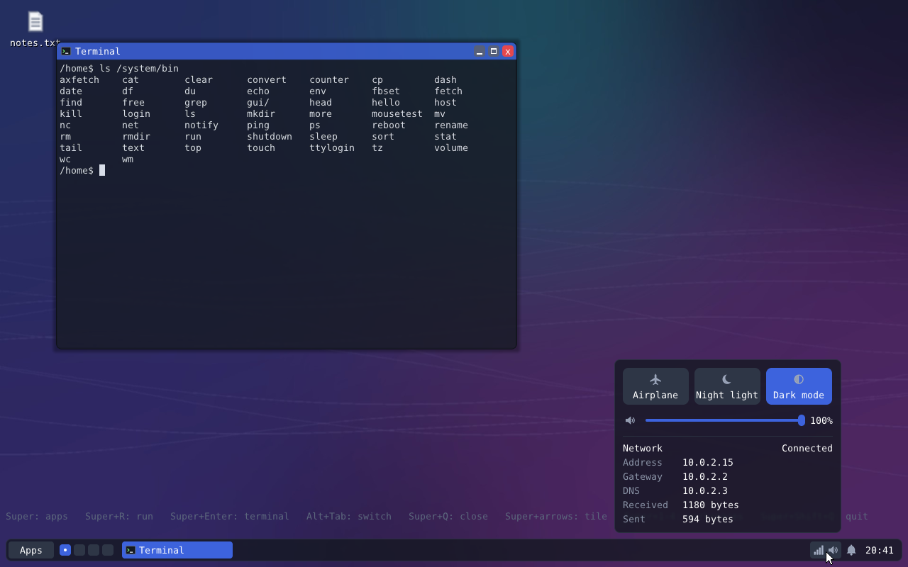

# AximOS

A hobby operating system for x86-64, written from scratch in C: its own kernel,
libc and window system, a desktop with a dozen apps, and a POSIX-ish userland
with the dash shell.



## Features

### Kernel

- 64-bit, booted by [Limine](https://limine-bootloader.org) with UEFI, on up to 64 CPUs
- Preemptive multitasking with processes and threads, `fork`, `exec`, signals and process groups
- Virtual memory: demand-paged stacks, `mmap`, shared memory, and read-only ELF segments
  shared between processes
- Dynamically linked programs: `libc.so` is also the dynamic linker
- Filesystems: FAT32 (read and write) on disks and their GPT or MBR partitions, ISO 9660
  on the install disc or a USB stick it's written to, tmpfs on `/tmp` (kept in memory, empty each boot), `/proc` and `/dev`
- Drives as they are in `/dev/disk`, for partitioning and formatting: opening one to
  write takes its filesystems away, and closing it mounts what's there
- Drives over AHCI (SATA) and legacy IDE, and USB sticks and drives over xHCI (USB 3
  controllers)
- USB keyboards and mice, through their boot protocol, which is how many laptops' own
  keyboards are connected. USB devices are found at boot only, on the computer's own
  ports, not through hubs
- Networking on an Intel e1000: ARP, IPv4, ICMP, UDP, TCP, DHCP and DNS, through BSD sockets
- Intel HDA sound, with a mixer for several programs at once
- Pseudo-terminals, a framebuffer console, PS/2 keyboard and mouse, and the VMware/QEMU
  absolute pointer
- ACPI through [uACPI](https://github.com/uACPI/uACPI), which runs the firmware's own code:
  shutting down and rebooting, the power button, which shuts down cleanly, the lid, and
  the battery in `/proc/battery`, read through the laptop's embedded controller
- Clocks measured by the PIT, or the HPET or what the CPU says where the PIT is switched off
- The kernel's log on screen while it boots and in `/proc/log`, and a crash shown on screen
  with where the kernel was, by function name, for machines without a serial port

### Desktop

- Smooth text in DejaVu Sans, and DejaVu Sans Mono in the terminal, the editor and text
  boxes, or the 8x16 bitmap font for those who'd rather have it sharp
- **wm**, a compositing window manager: rounded, anti-aliased windows with shadows,
  resizing from every edge, snapping to halves and quarters, layouts on the maximize
  button, minimizing, four workspaces, Alt+Tab, and an overview of every window side by side
- Resting the mouse on a taskbar button shows a live copy of its window
- Windows grow and fade in as they open, shrink away as they close, and fly to and
  from their taskbar buttons when minimized and restored, and move smoothly into place
  when maximized, restored or tiled. Menus and the taskbar's panels
  fade and slide in and out, and locking, logging in and logging out fade the screen
  across. Settings can turn all of it off.
- A floating, see-through taskbar at the top or bottom, which can hide itself (and still
  takes clicks at the very edge of the screen), with a start menu sorted into folders
  that searches the apps as you type, opened by throwing the mouse into the corner, and a
  show desktop corner at the other end
- Blurred glass for the taskbar, title bars, menus, panels, notifications and the
  window switcher, and for any window that asks for it (the terminal does). Settings
  can turn off the blur, or the transparency altogether, and set how round corners are, down
  to square
- A tray with quick settings (airplane mode, night light, dark mode, do not disturb,
  volume), the network, notifications, a calendar, and the clipboard's history, to put
  back something copied earlier
- Notifications that can carry a button, and stack up when one app sends several
- Soft sounds of its own for notifications, logging in and out, the volume, snapping
  windows and screenshots, made as they play, which Settings can turn off
- Screenshots of the screen, a window, or an area dragged across, saved to Pictures
  and copied
- Desktop icons on a grid, drag and drop between apps, and a clipboard for text and pictures
- A log-in screen, a lock screen and first-boot setup. Booting to text asks for the
  same account.
- Light and dark themes, eight accent colours, wallpapers, resolution, time zones and
  12 or 24 hour time, all set in Settings
- Display scaling at 1x or 2x, chosen under Settings > Display and applied at once. At
  2x everything on the desktop is twice the size, each pixel drawn as four, while apps
  keep working in the desktop's own pixels. It's 2x by default on screens 2560 wide or
  more, and 1x on smaller ones, unless `/system/etc/gui.conf` says `scale 1` or `scale 2`
- **libgui**, an immediate-mode toolkit for apps: buttons, text boxes with undo,
  lists, tabs, menus, dialogs, a file picker, a code editor with syntax colouring,
  PNG/JPEG/BMP images and TrueType text

### Apps

| App        | What it does                                                          |
|------------|-----------------------------------------------------------------------|
| NetSurf    | Web browser, with HTTPS, CSS, smooth text, PNG, JPEG, GIF and WebP pictures, some JavaScript, downloads to ~/Downloads, and the system clipboard |
| Files      | File manager: places, recent files, search through folders, tabs, multi-select, thumbnails, Open with, and a trash you can restore from |
| Terminal   | Tabs, scrollback, selection, find, and a see-through background       |
| Editor     | Tabs, find and replace, go to line, colouring for C and shell scripts |
| Paint      | Pencil, shapes, fill, text, selections, zoom, undo and redo           |
| Viewer     | PNG, JPEG, BMP, GIF and WebP pictures, with zoom and turning          |
| Player     | WAV, MP3, FLAC, Vorbis, Opus and AAC, with shuffle and repeat         |
| Calculator | With a history                                                        |
| Tasks      | What's running, sortable, with a graph of CPU and memory use          |
| Install    | Installs AximOS on a drive, from the ISO, which boots straight into it |
| Settings   | Theme, accent, display, taskbar, keyboard and mouse, sound, date and time, and default apps |
| Snake      | Three speeds, each with its own best score                            |

### Command line

`dash`, plus `ls cat cp mv rm mkdir rmdir touch rename stat find grep sort head
tail wc more du df free ps top kill date tz sleep env echo clear`, `disk` (lists drives,
partitions them with GPT and formats them as FAT32), network tools
(`net ping host nc fetch curl`, where `fetch` and `curl` speak HTTPS through mbedTLS), `lua` (Lua 5.4), `volume`,
`convert` for audio files, `notify`, `text` (an editor in the terminal) and `axfetch`.
Run any of them with `--help`.

At the prompt, the arrow keys, Home and End, Tab completion, Ctrl+W and Ctrl+arrows (or
Alt+B, Alt+F and Alt+D) edit the line, and Ctrl+R searches the history, which is kept
in `~/.history`. Lua's prompt edits lines the same way.

## Building

AximOS builds on Linux. You need:

- GCC and binutils for x86-64
- [Limine](https://limine-bootloader.org), installed in `/usr/share/limine`
- `xorriso`, `mtools`, `curl` and the tz database (`/usr/share/zoneinfo`)
- QEMU (`qemu-system-x86_64`) and OVMF, its UEFI firmware (`/usr/share/edk2/x64/OVMF.4m.fd`), to run it
- Python 3 with Pillow and NumPy for the tests
- `gperf`, `flex`, `bison` and `pkg-config` to build NetSurf
- `sdl2` and `libdrm`, only for `make linux`

On Arch or CachyOS:

```bash
sudo pacman -S --needed base-devel limine xorriso mtools curl tzdata qemu-full edk2-ovmf python-pillow python-numpy gperf
```

Then:

```bash
make
```

This builds `build/disk.img` (a 512 MB FAT32 disk with the system) and `build/aximos.iso`
(the kernel, the bootloader and the same system, which boots by itself to install it). The first build downloads the source of dash, Lua, mbedTLS,
zlib, curl, NetSurf, libwebp, the DejaVu fonts, stb_truetype and the audio codecs into `ports/dist`, checks their SHA-256 sums, and builds
them against AximOS's own libc.

## Running

```bash
make run
```

| Target             | What it does                                       |
|--------------------|----------------------------------------------------|
| `make run`         | Run what's built, on an AHCI drive                 |
| `make run-ide`     | Run on the older (and slower) IDE controller       |
| `make run-installer` | Boot the ISO with a blank 2 GB disk to install on, kept in `build/install.img` |
| `make run-usb`     | The same, with the ISO on a USB stick instead of a CD |
| `make build-run`   | Rebuild what changed, then run                     |
| `make debug`       | Also build `build/aximos-debug.iso`, which boots to the shell instead of the desktop |
| `make linux`       | Build wm and the calculator, Snake, the editor and Paint for Linux, in `build/linux` |
| `make test`        | Run the tests                                      |
| `make clean`       | Delete everything built                            |

QEMU uses KVM when the host has it. Sound goes to PipeWire; pass another backend with
`make run AUDIO=pa`, for example. The serial port goes to the terminal you ran it from,
where the kernel and wm log what they're doing.

### On Linux

`make linux` builds wm and some of the apps for Linux. From a desktop, wm runs in a
window, with the apps in its start menu:

```bash
build/linux/wm
```

From a text console (Ctrl+Alt+F3, say), it takes over the screen itself through DRM,
reading the keyboard, mouse and touchpad from `/dev/input`, which needs the `input`
group. `--window` and `--drm` pick one or the other. Super+Shift+Q quits, and puts the
console back. The apps also run by themselves, in windows of their own, from
`build/linux/apps`.

### Installing

The ISO boots by itself into the installer, which erases the drive you choose, gives it
one FAT32 partition the firmware boots from, and copies the system onto it. From then on
the installed system is used, even with the ISO still in. The PC has to boot with UEFI.

To install from a USB stick, write the ISO to it, which erases the stick:

```bash
sudo dd if=build/aximos.iso of=/dev/sdX bs=4M conv=fsync
```

where `/dev/sdX` is the stick (`lsblk` lists them). The stick has to be plugged in
before the PC starts.

### First boot

The first boot asks for your time zone (the clock starts out showing 12 hour time) and
to make an account. After that it starts at the log-in screen.
Hold **Shift** while it boots to get the text console instead, which asks for the same
username and password.

### Keyboard shortcuts

| Keys                | Does                                  |
|---------------------|---------------------------------------|
| Super               | Start menu                            |
| Super+R             | Run a program, folder or file         |
| Super+Enter         | Terminal                              |
| Alt+Tab             | Switch windows                        |
| Super+Tab           | See every window, and pick one        |
| Super+Q             | Close the window                      |
| Super+arrows        | Maximize, or tile to a side, then Up or Down for a quarter |
| Super+1 to 4        | Change workspace                      |
| Super+Shift+Q       | Leave the desktop                     |
| Print Screen        | Save the screen, and copy it          |
| Alt+Print Screen    | The same, of the focused window       |
| Shift+Print Screen  | Choose an area or window to save (also Super+Shift+S) |

## Tests

```bash
make test
```

Each `tests/*_test.py` boots its own QEMU from a snapshot of the built disk, drives it
over the serial port and QEMU's monitor (typing, clicking, taking screenshots), and checks
what happens. They cover the kernel (files, memory, threads, timers, the network, `/proc`),
the libraries, the shell and utilities, and every app. Several run at once, the slowest
first; `make test JOBS=2` runs fewer, and `make test TESTS="tests/files_test.py"` runs
just the ones named.

## Layout

```
src/, include/   the kernel
abi/             what the kernel and programs share: syscall numbers and structures
user/libc/       the C library, also the dynamic linker
user/libgui/     the GUI toolkit
user/libaudio/   reading and writing sound files, through user/codecs/
user/wm/         the window manager
user/<name>/     every other folder is a program
rootfs/          copied onto the disk as it is: settings, icons, fonts, wallpapers
ports/           downloads and builds dash, Lua, mbedTLS, zlib, curl, NetSurf, libwebp, stb_truetype and the codecs
tests/           the tests, and vm.py, which drives QEMU for them
```

On the disk, programs are in `/system/bin`, apps in `/system/bin/gui` (in folders that
become the start menu's), libraries in `/system/lib`, settings in `/system/etc` as plain
text, and your files in `/home`.

## Status

AximOS is developed and tested in QEMU. It hasn't been tried on real hardware yet.

## Credits

AximOS uses [Limine](https://github.com/limine-bootloader/limine), [uACPI](https://github.com/uACPI/uACPI),
[dash](http://gondor.apana.org.au/~herbert/dash/), [Lua](https://www.lua.org),
[Mbed TLS](https://github.com/Mbed-TLS/mbedtls), [zlib](https://zlib.net), [curl](https://curl.se),
[NetSurf](https://www.netsurf-browser.org), [libwebp](https://chromium.googlesource.com/webm/libwebp),
[stb_truetype](https://github.com/nothings/stb), the
[DejaVu](https://dejavu-fonts.github.io) fonts, and for sound
[libogg, libvorbis, Opus, FLAC](https://xiph.org), [minimp3](https://github.com/lieff/minimp3),
[shine](https://github.com/toots/shine), [FAAD2 and FAAC](https://github.com/knik0).
Each is under its own license.
